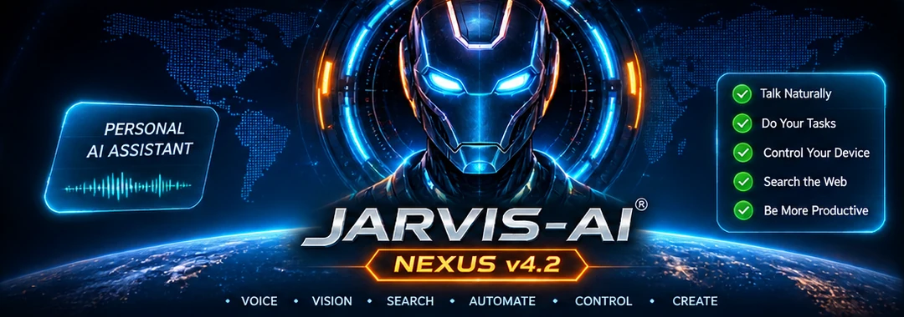

# JARVIS NEXUS — Voice-first AI assistant

A cyberpunk-styled, local-first Windows assistant with a browser dashboard, authenticated FastAPI endpoints, Hindi/English voice input (browser-dependent), local Ollama chat, safe allowlisted desktop launches, tasks, reminders and YouTube search/player integration.



## Status and limitations

**Prototype, not a hosted Anna AI app or a native mobile assistant.** The current backend is designed to run on Windows loopback (`127.0.0.1`). It must **not** be publicly deployed as-is. The mobile layout is web responsive, but mobile OS controls, background voice listening, contacts and remote Windows execution are not implemented. Browser speech recognition may require internet and permissions. YouTube autoplay may be blocked.

## Quick start — Windows PowerShell

```powershell
cd "C:\path\to\JARVIS-NEXUS"
py -m venv .venv
.\.venv\Scripts\python.exe -m pip install -r requirements.txt
$env:JARVIS_TOKEN = [guid]::NewGuid().ToString('N')
$env:JARVIS_AI_PROVIDER = 'ollama'
$env:OLLAMA_MODEL = 'qwen2.5:1.5b'
Set-Clipboard -Value $env:JARVIS_TOKEN
.\.venv\Scripts\python.exe -m uvicorn app:app --host 127.0.0.1 --port 8000
```

Open `http://127.0.0.1:8000`, click **Set access token**, paste with **Ctrl+V**. Do not copy other text between copying the token and pasting it. For local AI, install Ollama and pull `qwen2.5:1.5b` separately.

## Test

```powershell
.\.venv\Scripts\python.exe -m pip install pytest httpx
.\.venv\Scripts\python.exe -m pytest -q
```

## Architecture

- `app.py` — FastAPI backend, token auth, SQLite tasks/history, allowlisted Windows commands, Ollama and video lookup.
- `index.html` — responsive dashboard, browser voice, safe browser navigation.
- `test_app.py` — backend unit tests; mocked Ollama and video metadata are **not live integrations**.
- `MOBILE-ARCHITECTURE.md` — proposed native mobile/cloud roadmap, not shipped features.
- `ANNA-REVIEW-CHECKLIST.md` — Anna AI OS publication blockers and listing draft.

## Security boundaries

Bind only to `127.0.0.1`. Never expose this backend, its token, SQLite database, local workspace, or Ollama port to the public internet. Keep secrets out of Git. Desktop app launches are allowlisted and require confirmation. For cloud/Anna publishing, create a separate sandboxed, authenticated, HTTPS-hosted version without direct desktop control.

## Roadmap

- [x] Local FastAPI dashboard and auth
- [x] Browser voice input and safe browser actions
- [x] Deterministic local date/time shortcuts
- [ ] Measured voice latency and browser-device regression testing
- [ ] Production-grade multiuser cloud gateway and permissions
- [ ] Native Android/iOS integrations
- [ ] Anna Executa, UI Runtime packaging and review submission

License: not selected. Add a LICENSE file only after choosing licensing terms.
